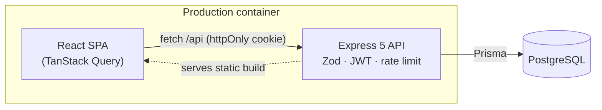

# 💰 Ledgerly — Expense Tracker for Australia & New Zealand


A full-stack personal finance app that tracks income and expenses **by the Australian or New Zealand financial year** and produces a **GST summary** (useful for sole traders preparing a BAS or GST return).

**Live demo:** _coming soon_ · **Demo login:** `demo@example.com` / `Demo1234!` (or click **“Try the demo account”**)

<!-- Add screenshots to docs/ and uncomment:


-->

## Features

- **Secure authentication** — bcrypt-hashed passwords, JWT in an `httpOnly` cookie, rate-limited login
- **Transactions CRUD** — add, edit, delete, filter by type / category / date range, debounced search, pagination
- **Region-aware finance logic**
  | | 🇦🇺 Australia | 🇳🇿 New Zealand |
  |---|---|---|
  | Currency | AUD | NZD |
  | GST | 10% (1/11 of inclusive price) | 15% (3/23 of inclusive price) |
  | Financial year | 1 Jul – 30 Jun | 1 Apr – 31 Mar |
  | Tax authority | ATO | IRD |
- **Dashboard** — income, expenses, net savings, savings rate, monthly cash-flow chart, spending by category
- **GST report** — GST collected vs. GST credits, net payable / refundable
- **CSV export** — with protection against spreadsheet formula injection
- **Responsive UI** with automatic dark mode; tables collapse into cards on mobile

## Tech stack

| Layer | Tech |
|---|---|
| Frontend | React 18, TypeScript, Vite, React Router, TanStack Query, Recharts |
| Backend | Node.js, Express 5, TypeScript, Zod validation |
| Database | PostgreSQL 16, Prisma ORM |
| Testing | Vitest, Supertest (API integration tests against a real Postgres), React Testing Library |
| DevOps | Docker (multi-stage), docker-compose, GitHub Actions CI |

## Architecture



In production a single container serves both the API and the built React app, which avoids CORS and cross-site cookie issues.

```
├── client/           React + Vite frontend
│   └── src/
│       ├── components/   TransactionForm, Modal, Layout
│       ├── pages/        Dashboard, Transactions, Settings, Login, Register
│       └── lib/          API client, auth hook, region/GST helpers
├── server/           Express API
│   ├── prisma/       schema, migrations, demo seed
│   ├── src/
│   │   ├── lib/      region.ts (GST & FY rules), summary.ts (reporting)
│   │   ├── routes/   auth, transactions, reports
│   │   └── middleware/
│   └── tests/        unit + integration
├── Dockerfile
└── docker-compose.yml   local Postgres (dev + test databases)
```

## Getting started

Prerequisites: Node.js 20+, Docker Desktop

```bash
npm install
npm run db:up                         # start Postgres in Docker
cp server/.env.example server/.env    # then set a real JWT_SECRET
npm run db:migrate -w server          # apply migrations
npm run db:seed -w server             # optional: demo user + 14 months of data
npm run dev                           # API on :4000, web on http://localhost:5173
```

## Testing

```bash
npm test            # server unit + integration tests, client component tests
npm run typecheck
```

The integration suite runs against a separate `expense_test` database and covers auth, validation, filtering, CSV export, FY/GST reporting and **authorisation (users cannot read or modify other users’ data)**.

## API

| Method | Endpoint | Description |
|---|---|---|
| POST | `/api/auth/register` | Create account |
| POST | `/api/auth/login` | Log in (sets cookie) |
| POST | `/api/auth/logout` | Log out |
| GET / PATCH | `/api/auth/me` | Current user / update name & region |
| GET | `/api/transactions` | List (`type`, `category`, `from`, `to`, `search`, `page`, `pageSize`) |
| POST | `/api/transactions` | Create |
| PUT / DELETE | `/api/transactions/:id` | Update / delete |
| GET | `/api/transactions/export.csv` | CSV export (same filters) |
| GET | `/api/reports/summary?fy=2026` | Financial-year summary incl. GST |

## Design decisions

- **Money is stored as integer cents** to avoid floating-point rounding errors.
- **Financial years are named by the year they end** (AU FY2026 = 1 Jul 2025 – 30 Jun 2026), matching ATO/IRD convention.
- **GST is derived, not stored** — changing region recalculates reports without migrating data.
- **Ownership checks on every query** (`where: { id, userId }`) return 404 rather than 403 to avoid leaking which IDs exist.
- **Same error for unknown email and wrong password** to prevent account enumeration.

## Deployment

The `Dockerfile` builds one image that runs migrations on start-up. It works on any container host, for example:

1. Create a free PostgreSQL database on [Neon](https://neon.tech).
2. Create a **Web Service** on [Render](https://render.com) from this repo using the Dockerfile.
3. Set the environment variables `DATABASE_URL`, `JWT_SECRET` (a long random string) and `NODE_ENV=production`.
4. Optionally run the seed once to create the demo account.

## Roadmap

- Recurring transactions (rent, subscriptions)
- Monthly budgets per category with alerts
- Receipt photo upload
- Bank CSV import (CommBank, ANZ, Westpac, NAB, Kiwibank formats)
